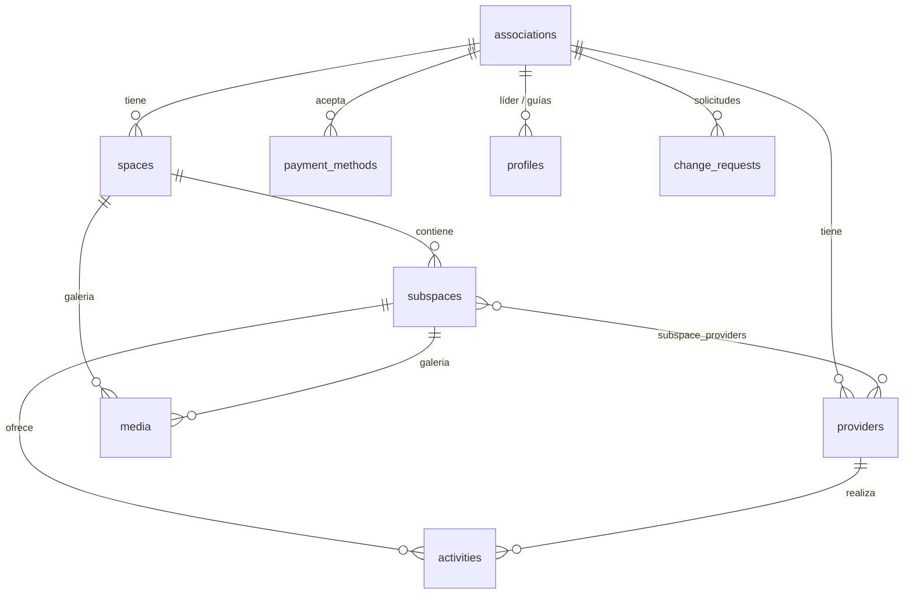

# Bosque Seco · Piura

Portal web de ecoturismo comunitario del bosque seco del norte de Perú. Reúne a las asociaciones que gestionan espacios de visita, y cada una administra su propia información desde un panel con **aprobación del administrador**. Bilingüe (**español / inglés**) y con base de datos compartida con la app móvil.

## Cómo funciona

```text
Admin (AIDER) ── crea asociaciones y líderes, aprueba cambios
└── Asociación            (1 líder, N guías/prestadores)
    └── Espacios          (1:N, pueden abarcar varios departamentos)
        └── Subespacios   (1:N)
            ├── Actividades con tarifa
            └── Galería (flora · fauna · paisaje · instalaciones)
```

1. El **líder** carga espacios, prestadores, actividades, medios de pago e imágenes.
2. Cada cambio es una **solicitud pendiente**; el líder nunca publica directamente.
3. El **admin** aprueba o rechaza; al aprobar, el contenido aparece en el portal.
4. El **turista** explora por departamento y contacta por WhatsApp **a los guías** (nunca al líder).

## Stack

| Capa | Tecnología |
|---|---|
| Frontend | React 19 + Vite, React Router, CSS Modules |
| i18n | i18next · react-i18next (ES / EN) |
| Datos y auth | Supabase (Postgres + RLS, Auth, Storage) |
| Mapas | Leaflet / react-leaflet |
| Calidad | oxlint, Vitest + Testing Library, EditorConfig, GitHub Actions |

## Modelo de datos



## Seguridad

- **RLS en todas las tablas:** lectura pública solo de lo activo; escritura de contenido solo por el admin.
- **Solicitudes de cambio:** el líder solo inserta en `change_requests`; la aprobación (`approve_change_request`) usa una **lista blanca de columnas** y verifica que toda referencia pertenezca a la misma asociación.
- **WhatsApp:** una restricción de base de datos impide guardarlo en prestadores que no sean guías; el teléfono del líder no existe en la base pública.
- **Claves:** el cliente usa solo la clave *publishable*. La *service role* y los tokens nunca van en el frontend (`.env.local` está ignorado por Git).
- **Archivos:** el líder solo sube a la carpeta de su asociación y con límite de 5 MB (JPG, PNG, WebP).

## Empezar

```powershell
npm install
copy .env.example .env.local   # completar URL y clave publicable de Supabase
npm run dev
```

| Script | Uso |
|---|---|
| `npm run dev` | Servidor de desarrollo |
| `npm run build` | Compilación de producción |
| `npm run lint` | Análisis estático |
| `npm test` | Pruebas unitarias (Vitest) |
| `npm run test:watch` | Pruebas en modo continuo mientras desarrollas |
| `npm run preview` | Previsualizar la compilación |

## Estructura

```text
src/
├── app/          Router
├── layouts/      PublicLayout, AdminLayout
├── pages/        public/ y admin/
├── features/     home · destinations · ecosystem · community · visit
│                 associations · auth · admin
├── components/   shared/
├── services/     acceso a datos (Supabase)
├── lib/          cliente Supabase, utilidades
├── i18n/         configuración y locales es/en
└── styles/       variables y estilos globales
supabase/         migraciones y seed (versionados)
docs/             diseño, contexto del proyecto e imágenes de referencia
```

## Base de datos

Las migraciones están en `supabase/migrations/` y se aplican con la CLI:

```powershell
npx supabase link --project-ref <ref>
npx supabase db push --dry-run   # revisar primero
npx supabase db push
```

> Una sola persona aplica migraciones; el esquema se acuerda con el equipo móvil antes de cambiarlo.

## Colaboración

Ramas, commits y Pull Requests: ver [CONTRIBUTING.md](CONTRIBUTING.md).
